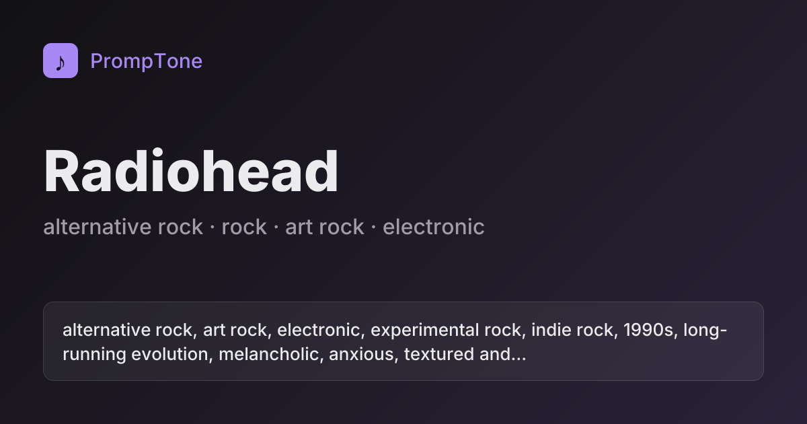
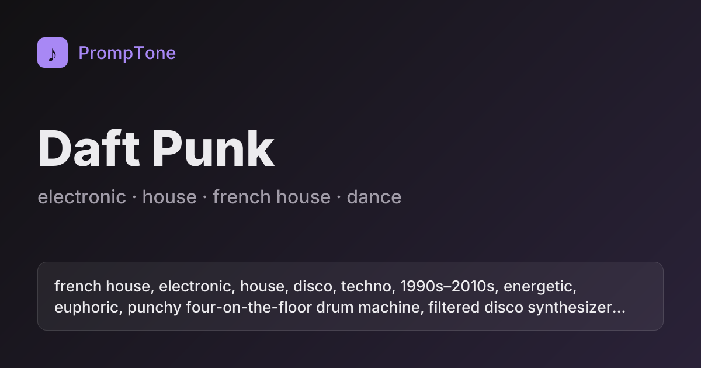
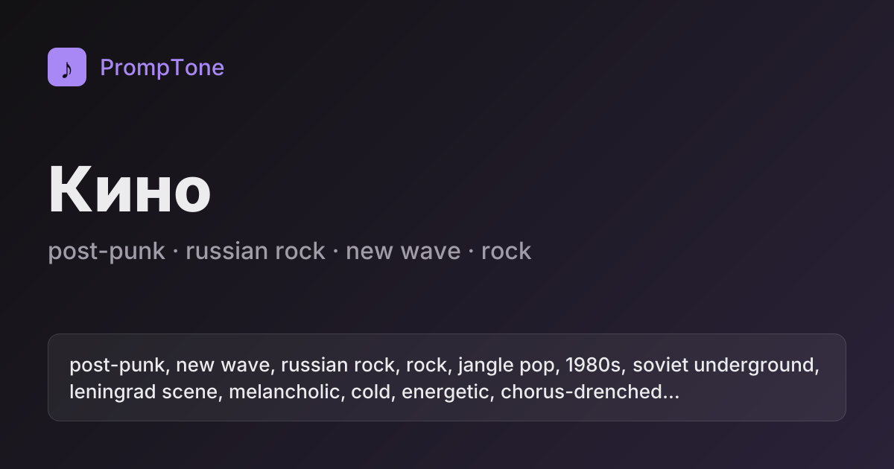

# PrompTone

**Style prompts for Suno and Udio — the sound of an artist, an album or an era in one line.**

👉 **[promptone.pro](https://promptone.pro/en)** · [Examples](EXAMPLES.md) · [Dataset](#dataset) · [Русский](README.ru.md)


Want a track that sounds like early Radiohead, *Kid A* or a mix of Daft Punk and Beethoven? Suno strips artist
names from the Style field and may reject the request. PrompTone describes the sound itself — genre, era,
instruments, vocals, production, tempo, mood — so you can paste it straight into the generator.

**Mix artists into a new style** — try [Radiohead × Beethoven](https://promptone.pro/en/mix?s=radiohead~general~~50&s=ludwig-van-beethoven~general~~50).

- **610 artists and composers**, over **11,000 prompts** — rock, metal, pop, hip hop, electronic, jazz, world,
  classical and opera.
- **Levels:** overall style · every studio album · live albums · eras (albums grouped by similar sound).
  Composers get genres (operas, symphonies…) and periods.
- **Mix styles:** blend up to three artists, albums or eras with adjustable shares — e.g.
  [Radiohead × Beethoven](https://promptone.pro/en/mix?s=radiohead~general~~50&s=ludwig-van-beethoven~general~~50); take vocals from another source.
- **Suno and Udio** versions of every prompt, Exclude Styles for Suno, a live-sound toggle.
- **Any artist on demand:** not in the catalog? The site finds them on MusicBrainz and generates prompts in a minute.
- Free, no sign-up.

## Example: Radiohead

| Level | Suno · Style |
| --- | --- |
| Overall style | `alternative rock, art rock, electronic, experimental rock, indie rock, 1990s, long-running evolution, melancholic, anxious, textured and effects-laden electric guitar, atmospheric synthesizer, expressive male vocals, layered studio production, varied mid-tempo` |
| *OK Computer* (1997) | `art rock, alternative rock, space rock revival, experimental, 1990s, third album, atmospheric expansion, cold, existential, atmospheric and delayed electric guitar, spacey synthesizer textures, distant male vocals, spacious production, slow atmospheric build` |
| *Kid A* (2000) | `electronic, experimental rock, art rock, ambient, post-rock, 2000s, electronic reinvention, cold, alienated, glitchy and layered synthesizer, programmed drum machine beats, falsetto male vocals, dense electronic production, unpredictable shifting tempo` |
| Exclude Styles | `autotune, rap vocals, country twang` |

The same sound for Udio: `alternative rock, art rock, electronic, melancholic, anxious, 1990s, textured and effects-laden electric guitar, atmospheric synthesizer, expressive male vocals, layered studio production, varied mid-tempo, no autotune, no rap vocals`

More — [100 popular artists and 20 composers](EXAMPLES.md), everything else — [on the site](https://promptone.pro/en).

<p>
  
  
  
  
</p>

## How to use

1. Find an artist or genre on [promptone.pro](https://promptone.pro/en) and pick a level: overall style, an album,
   a live album or an era.
2. **Suno:** Custom mode → paste the line into *Style of Music*; paste *Exclude Styles* into the field of the same
   name in the advanced options.
3. **Udio:** switch the site to Udio — exclusions go right into the line (`no …`) — and paste it into the
   description.
4. Rate the result with **Yes / No** under the prompt: votes push good prompts up, bad ones get regenerated.

## How the prompts are made

The language model never describes music from memory.

1. **Facts first.** Discography with years, members and tracklists — [MusicBrainz](https://musicbrainz.org);
   tags — [Last.fm](https://www.last.fm); works of composers — [Wikidata](https://www.wikidata.org).
2. **Facts → sound profile.** An LLM only turns the facts into a neutral profile of short tags: genre, era,
   instruments, vocals, production, tempo, mood and what to avoid. Few facts — a shorter, more careful prompt.
3. **Profile → prompt.** Deterministic rules render the profile for each generator with its own length limit,
   tag order and exclusions.
4. **No names.** Every prompt is checked against the names of artists, members, producers, albums and songs.
   A prompt with a name is never published.

## Dataset

[`data/prompts.json`](data/prompts.json) and [`data/prompts.csv`](data/prompts.csv) — everything the site shows in
English, updated from time to time.

**JSON** — one object per artist:

```json
{
  "slug": "radiohead", "name": "Radiohead", "latinName": null, "kind": "performer",
  "country": "GB", "beginYear": 1991, "endYear": null,
  "genres": ["Grunge and alternative", "Indie rock"],
  "url": "https://promptone.pro/en/artists/radiohead",
  "levels": {
    "general": [{ "title": "", "note": null, "suno": "…", "sunoExclude": "…", "udio": "…",
                  "sunoLive": "…", "udioLive": "…", "status": "unverified" }],
    "albums": [{ "title": "OK Computer", "note": "1997", "suno": "…", … }],
    "live": […], "eras": […]
  }
}
```

Levels: `general`, `albums` (studio), `live`, `eras`, `genres` (composers: operas, symphonies…).
`latinName` — Latin spelling for Cyrillic names. `status` — `unverified` until visitors vote.

**CSV** — one row per prompt: `artist, artist_latin, country, level, title, note, suno_style, suno_exclude,
udio_style, url`.

## Feedback

Found a bad prompt, missing an artist or have an idea — [open an issue](https://github.com/psihovnet/promptone/issues/new/choose).

## License

Prompts and the dataset — [CC0](LICENSE), public domain: use them anywhere, including commercially, no attribution
required. A link to [PrompTone](https://promptone.pro) is appreciated but optional. Facts: MusicBrainz and Wikidata
(CC0), Last.fm.

Made by Artem Kvashennikov.
