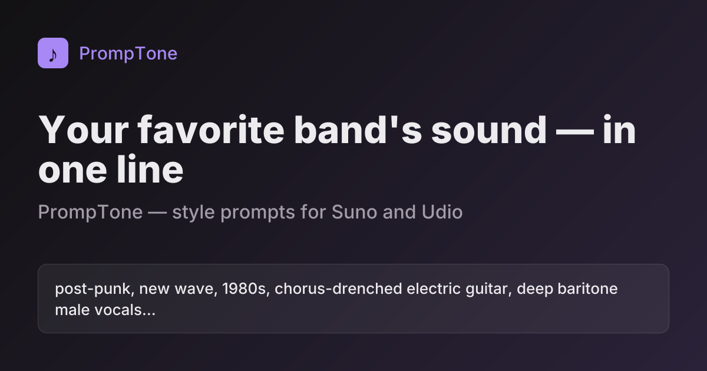

# PrompTone

**Промпты стилей для Suno и Udio — звучание артиста, альбома или периода в одну строку.**

👉 **[promptone.pro](https://promptone.pro)** · [Примеры](EXAMPLES.md) · [Датасет](#датасет) · [English](README.md)

Хотите трек в духе раннего Radiohead, «Группы крови» или смесь Daft Punk с Бетховеном? Suno вырезает имена
артистов из поля Style и может отклонить запрос. PrompTone описывает само звучание — жанр, эпоху, инструменты,
вокал, продакшн, темп, настроение, — и строку можно сразу вставить в генератор.

- **610 артистов и композиторов**, больше **11 000 промптов** — рок, метал, поп, хип-хоп, электроника, джаз,
  музыка мира, классика и опера. Большой раздел русского рока.
- **Уровни:** общий стиль · каждый студийный альбом · концертные · периоды (альбомы, сгруппированные по близкому
  звучанию). У композиторов — жанры (оперы, симфонии…) и периоды.
- **Смешивание стилей:** до трёх артистов, альбомов или периодов с долями; вокал можно взять у другого источника.
- **Suno и Udio** — свой вариант каждого промпта, Exclude Styles для Suno, переключатель «Концертное звучание».
- **Любой артист по запросу:** нет в базе — сайт найдёт его в MusicBrainz и сгенерирует промпты за минуту.
- Бесплатно и без регистрации.

Пример промптов по уровням и формат датасета — в [английской версии](README.md#example-radiohead).

## Как пользоваться

1. Найдите артиста или жанр на [promptone.pro](https://promptone.pro) и выберите уровень.
2. **Suno:** режим Custom → строку в поле *Style of Music*; *Exclude Styles* — в одноимённое поле
   в дополнительных настройках.
3. **Udio:** переключите сайт на Udio — исключения окажутся прямо в строке (`no …`) — и вставьте её в описание.
4. Оцените результат кнопками **Да / Нет** под промптом: удачные поднимаются, неудачные перегенерируются.

## Как сделаны промпты

Языковая модель не вспоминает музыку по памяти.

1. **Сначала факты:** дискография с годами, участники и треклисты — [MusicBrainz](https://musicbrainz.org),
   теги — [Last.fm](https://www.last.fm), произведения композиторов — [Wikidata](https://www.wikidata.org).
2. **Факты → профиль звучания.** LLM только переводит факты в нейтральный профиль из коротких тегов. Мало фактов —
   короче и осторожнее промпт.
3. **Профиль → промпт.** Детерминированные правила собирают строку под каждый генератор: свой лимит длины,
   порядок тегов и исключения.
4. **Без имён.** Каждый промпт проверяется на имена артистов, участников, продюсеров, альбомов и песен.

## Датасет

[`data/prompts.json`](data/prompts.json) и [`data/prompts.csv`](data/prompts.csv) — всё, что показывает
английская версия сайта (названия жанров и подписи — на английском). Описание полей — в
[README](README.md#dataset).

## Обратная связь

Неудачный промпт, нет нужного артиста, есть идея — [создайте issue](https://github.com/psihovnet/promptone/issues/new/choose).

## Лицензия

Промпты и датасет — [CC0](LICENSE), общественное достояние: можно использовать где угодно, в том числе
коммерчески, без указания авторства. Ссылка на [PrompTone](https://promptone.pro) приятна, но не обязательна.
Факты: MusicBrainz и Wikidata (CC0), Last.fm.

Автор — Артём Квашенников.
